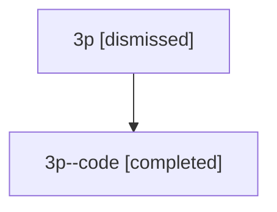

# Session: 3p

[Agent Hoods](../README.md) / [bbugyi200](../users/bbugyi200/README.md) / [athena](../users/bbugyi200/machines/athena/README.md) / [3p](../users/bbugyi200/machines/athena/hoods/3p/README.md) / 3p

Owner: `bbugyi200.athena` · Hood: `3p` · Members: 2

## Lineage

The diagram is an optional enhancement; the ordered table below contains the same lineage in accessible text.

| Role | Agent | State | Model / provider | Timing | Commits | Prompt | Chat |
|---|---|---|---|---|---:|---|---|
| root | 3p | dismissed | opus / claude | 2026-07-09T12:49:13.016170 → 2026-07-09T13:14:45.830506 | 0 | [Prompt](../agents/bbugyi200.athena.3p/prompt.md) | [Chat](../agents/bbugyi200.athena.3p/chat.md) |
| code | 3p--code | completed | gpt-5.5 / codex | 2026-07-09T17:04:17.350517+00:00 | [1](../agents/bbugyi200.athena.3p--code/README.md#commits) | — | [Chat](../agents/bbugyi200.athena.3p--code/chat.md) |

## Commits

| Role | Repo | Commit | Subject | Committed |
|---|---|---|---|---|
| code | — | `28168ad` | fix: include companion SDD artifacts in finalization | 2026-07-09 13:14:28 EDT |
