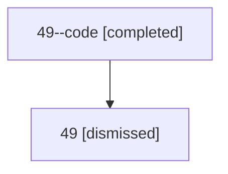

# Session: 49

[Agent Hoods](../README.md) / [bbugyi200](../users/bbugyi200/README.md) / [athena](../users/bbugyi200/machines/athena/README.md) / [49](../users/bbugyi200/machines/athena/hoods/49/README.md) / 49

Owner: `bbugyi200.athena` · Hood: `49` · Members: 2

## Lineage

The diagram is an optional enhancement; the ordered table below contains the same lineage in accessible text.

| Role | Agent | State | Model / provider | Timing | Commits | Prompt | Chat |
|---|---|---|---|---|---:|---|---|
| code | 49--code | completed | gpt-5.6-sol / codex | 2026-07-10T14:24:49.654071+00:00 | [1](../agents/bbugyi200.athena.49--code/README.md#commits) | — | [Chat](../agents/bbugyi200.athena.49--code/chat.md) |
| root | 49 | dismissed | gpt-5.6-sol / codex | 2026-07-10T10:17:24.472422 → 2026-07-10T10:53:06.279703 | 0 | [Prompt](../agents/bbugyi200.athena.49/prompt.md) | [Chat](../agents/bbugyi200.athena.49/chat.md) |

## Commits

| Role | Repo | Commit | Subject | Committed |
|---|---|---|---|---|
| code | — | `afe3701` | feat(xprompt)!: remove Mercurial workspace workflow references | 2026-07-10 10:52:50 EDT |
