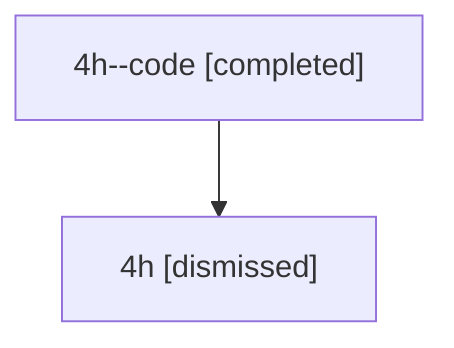

# Session: 4h

[Agent Hoods](../README.md) / [bbugyi200](../users/bbugyi200/README.md) / [athena](../users/bbugyi200/machines/athena/README.md) / [4h](../users/bbugyi200/machines/athena/hoods/4h/README.md) / 4h

Owner: `bbugyi200.athena` · Hood: `4h` · Members: 2

## Lineage

The diagram is an optional enhancement; the ordered table below contains the same lineage in accessible text.

| Role | Agent | State | Model / provider | Timing | Commits | Prompt | Chat |
|---|---|---|---|---|---:|---|---|
| code | 4h--code | completed | gpt-5.6-sol / codex | 2026-07-10T15:19:55.884906+00:00 | [1](../agents/bbugyi200.athena.4h--code/README.md#commits) | — | [Chat](../agents/bbugyi200.athena.4h--code/chat.md) |
| root | 4h | dismissed | gpt-5.6-sol / codex | 2026-07-10T11:16:09.985288 → 2026-07-10T11:28:39.910465 | 0 | [Prompt](../agents/bbugyi200.athena.4h/prompt.md) | [Chat](../agents/bbugyi200.athena.4h/chat.md) |

## Commits

| Role | Repo | Commit | Subject | Committed |
|---|---|---|---|---|
| code | — | `86c7034` | feat(vcs)!: make SDD log history opt-in | 2026-07-10 11:28:18 EDT |
