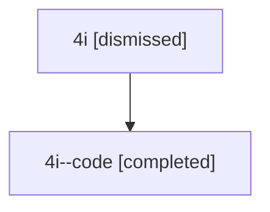

# Session: 4i

[Agent Hoods](../README.md) / [bbugyi200](../users/bbugyi200/README.md) / [athena](../users/bbugyi200/machines/athena/README.md) / [4i](../users/bbugyi200/machines/athena/hoods/4i/README.md) / 4i

Owner: `bbugyi200.athena` · Hood: `4i` · Members: 2

## Lineage

The diagram is an optional enhancement; the ordered table below contains the same lineage in accessible text.

| Role | Agent | State | Model / provider | Timing | Commits | Prompt | Chat |
|---|---|---|---|---|---:|---|---|
| root | 4i | dismissed | gpt-5.6-sol / codex | 2026-07-10T11:17:30.276768 → 2026-07-10T11:28:31.254219 | 0 | [Prompt](../agents/bbugyi200.athena.4i/prompt.md) | [Chat](../agents/bbugyi200.athena.4i/chat.md) |
| code | 4i--code | completed | gpt-5.6-sol / codex | 2026-07-10T15:21:11.267558+00:00 | [1](../agents/bbugyi200.athena.4i--code/README.md#commits) | — | [Chat](../agents/bbugyi200.athena.4i--code/chat.md) |

## Commits

| Role | Repo | Commit | Subject | Committed |
|---|---|---|---|---|
| — | — | `a141201` | chore: Add SDD prompt and plan for cli\_help\_output | 2026-06-09 18:15:19 EDT |
| — | — | `3161450` | feat: add compact root CLI help | 2026-06-09 18:24:52 EDT |
| code | — | `8d2179c` | fix(xprompt): preserve time-shaped wait dependency names | 2026-07-10 11:28:11 EDT |
