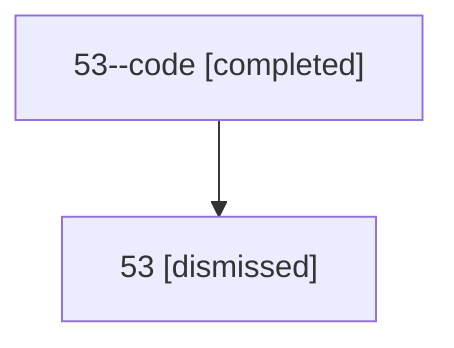

# Session: 53

[Agent Hoods](../README.md) / [bbugyi200](../users/bbugyi200/README.md) / [athena](../users/bbugyi200/machines/athena/README.md) / [53](../users/bbugyi200/machines/athena/hoods/53/README.md) / 53

Owner: `bbugyi200.athena` · Hood: `53` · Members: 2

## Lineage

The diagram is an optional enhancement; the ordered table below contains the same lineage in accessible text.

| Role | Agent | State | Model / provider | Timing | Commits | Prompt | Chat |
|---|---|---|---|---|---:|---|---|
| code | 53--code | completed | gpt-5.6-sol / codex | 2026-07-10T22:54:58.532868+00:00 | [1](../agents/bbugyi200.athena.53--code/README.md#commits) | — | [Chat](../agents/bbugyi200.athena.53--code/chat.md) |
| root | 53 | dismissed | gpt-5.6-sol / codex | 2026-07-10T18:51:02.604756 → 2026-07-10T19:12:50.600392 | 0 | [Prompt](../agents/bbugyi200.athena.53/prompt.md) | [Chat](../agents/bbugyi200.athena.53/chat.md) |

## Commits

| Role | Repo | Commit | Subject | Committed |
|---|---|---|---|---|
| — | — | `3dfd443` | chore: Add SDD prompt and plan for worker\_model\_handoffs | 2026-06-10 09:22:51 EDT |
| — | — | `6a680c1` | feat: route plan-implementation handoffs through the worker model lane | 2026-06-10 09:41:53 EDT |
| code | — | `8ee7fa5` | feat(memory)!: require explicit project opt-in | 2026-07-10 19:12:38 EDT |

## Neighbors

| Agent | Relation | State |
|---|---|---|
| [53.f-0](../agents/bbugyi200.athena.53.f-0/README.md) | descendant | dismissed |
