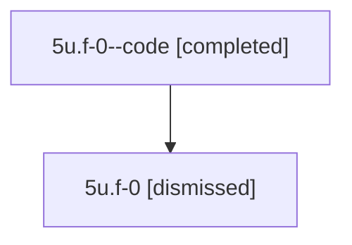

# Session: 5u.f-0

[Agent Hoods](../README.md) / [bbugyi200](../users/bbugyi200/README.md) / [athena](../users/bbugyi200/machines/athena/README.md) / [5u](../users/bbugyi200/machines/athena/hoods/5u/README.md) / 5u.f-0

Owner: `bbugyi200.athena` · Hood: `5u` · Members: 2

## Lineage

The diagram is an optional enhancement; the ordered table below contains the same lineage in accessible text.

| Role | Agent | State | Model / provider | Timing | Commits | Prompt | Chat |
|---|---|---|---|---|---:|---|---|
| code | 5u.f-0--code | completed | gpt-5.6-sol / codex | 2026-07-11T17:19:54.713345+00:00 | [1](../agents/bbugyi200.athena.5u.f-0--code/README.md#commits) | — | [Chat](../agents/bbugyi200.athena.5u.f-0--code/chat.md) |
| root | 5u.f-0 | dismissed | gpt-5.6-sol / codex | 2026-07-11T13:15:57.899422 → 2026-07-11T13:26:48.109841 | 0 | [Prompt](../agents/bbugyi200.athena.5u.f-0/prompt.md) | [Chat](../agents/bbugyi200.athena.5u.f-0/chat.md) |

## Commits

| Role | Repo | Commit | Subject | Committed |
|---|---|---|---|---|
| code | — | `1180425` | fix: sort custom revival rows by recency | 2026-07-11 13:26:32 EDT |

## Neighbors

| Agent | Relation | State |
|---|---|---|
| [5u](bbugyi200.athena.5u.md) (session · 2) | ancestor | completed 1, dismissed 1 |
