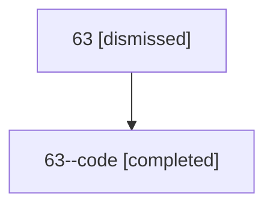

# Session: 63

[Agent Hoods](../README.md) / [bbugyi200](../users/bbugyi200/README.md) / [athena](../users/bbugyi200/machines/athena/README.md) / [63](../users/bbugyi200/machines/athena/hoods/63/README.md) / 63

Owner: `bbugyi200.athena` · Hood: `63` · Members: 2

## Lineage

The diagram is an optional enhancement; the ordered table below contains the same lineage in accessible text.

| Role | Agent | State | Model / provider | Timing | Commits | Prompt | Chat |
|---|---|---|---|---|---:|---|---|
| root | 63 | dismissed | claude-fable-5 / claude | 2026-07-11T16:21:07.154336 → 2026-07-11T17:15:07.028808 | 0 | [Prompt](../agents/bbugyi200.athena.63/prompt.md) | [Chat](../agents/bbugyi200.athena.63/chat.md) |
| code | 63--code | completed | gpt-5.6-sol / codex | 2026-07-11T20:29:14.463765+00:00 | [1](../agents/bbugyi200.athena.63--code/README.md#commits) | — | [Chat](../agents/bbugyi200.athena.63--code/chat.md) |

## Commits

| Role | Repo | Commit | Subject | Committed |
|---|---|---|---|---|
| code | — | `dcafd64` | feat(tui): redesign xprompt save panel | 2026-07-11 17:14:40 EDT |
