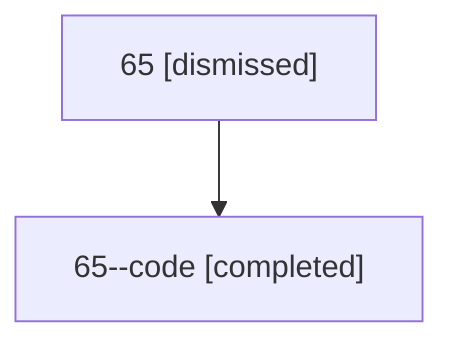

# Session: 65

[Agent Hoods](../README.md) / [bbugyi200](../users/bbugyi200/README.md) / [athena](../users/bbugyi200/machines/athena/README.md) / [65](../users/bbugyi200/machines/athena/hoods/65/README.md) / 65

Owner: `bbugyi200.athena` · Hood: `65` · Members: 2

## Lineage

The diagram is an optional enhancement; the ordered table below contains the same lineage in accessible text.

| Role | Agent | State | Model / provider | Timing | Commits | Prompt | Chat |
|---|---|---|---|---|---:|---|---|
| root | 65 | dismissed | claude-fable-5 / claude | 2026-07-11T17:11:33.814347 → 2026-07-11T17:31:44.411479 | 0 | [Prompt](../agents/bbugyi200.athena.65/prompt.md) | [Chat](../agents/bbugyi200.athena.65/chat.md) |
| code | 65--code | completed | gpt-5.6-sol / codex | 2026-07-11T21:20:55.231317+00:00 | [1](../agents/bbugyi200.athena.65--code/README.md#commits) | — | [Chat](../agents/bbugyi200.athena.65--code/chat.md) |

## Commits

| Role | Repo | Commit | Subject | Committed |
|---|---|---|---|---|
| code | — | `711120b` | fix: handle pinned prompt stash bundles consistently | 2026-07-11 17:31:29 EDT |
