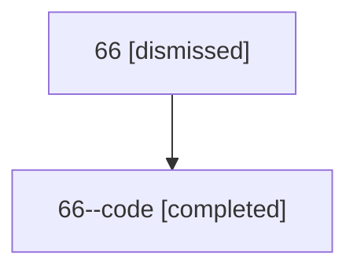

# Session: 66

[Agent Hoods](../README.md) / [bbugyi200](../users/bbugyi200/README.md) / [athena](../users/bbugyi200/machines/athena/README.md) / [66](../users/bbugyi200/machines/athena/hoods/66/README.md) / 66

Owner: `bbugyi200.athena` · Hood: `66` · Members: 2

## Lineage

The diagram is an optional enhancement; the ordered table below contains the same lineage in accessible text.

| Role | Agent | State | Model / provider | Timing | Commits | Prompt | Chat |
|---|---|---|---|---|---:|---|---|
| root | 66 | dismissed | claude-fable-5 / claude | 2026-07-11T17:16:01.023139 → 2026-07-11T17:56:06.955051 | 0 | [Prompt](../agents/bbugyi200.athena.66/prompt.md) | [Chat](../agents/bbugyi200.athena.66/chat.md) |
| code | 66--code | completed | gpt-5.6-sol / codex | 2026-07-11T21:27:31.299317+00:00 | [1](../agents/bbugyi200.athena.66--code/README.md#commits) | — | [Chat](../agents/bbugyi200.athena.66--code/chat.md) |

## Commits

| Role | Repo | Commit | Subject | Committed |
|---|---|---|---|---|
| code | — | `71effb3` | feat(sdd): nest prompt snapshots with monthly plans | 2026-07-11 17:55:54 EDT |
