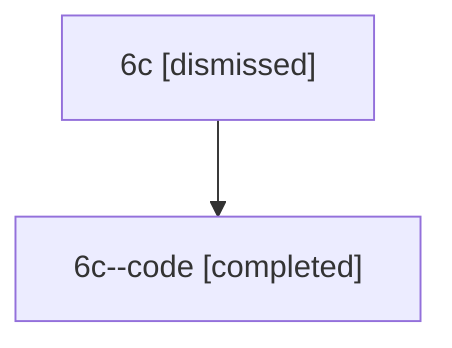

# Session: 6c

[Agent Hoods](../README.md) / [bbugyi200](../users/bbugyi200/README.md) / [athena](../users/bbugyi200/machines/athena/README.md) / [6c](../users/bbugyi200/machines/athena/hoods/6c/README.md) / 6c

Owner: `bbugyi200.athena` · Hood: `6c` · Members: 2

## Lineage

The diagram is an optional enhancement; the ordered table below contains the same lineage in accessible text.

| Role | Agent | State | Model / provider | Timing | Commits | Prompt | Chat |
|---|---|---|---|---|---:|---|---|
| root | 6c | dismissed | claude-fable-5 / claude | 2026-07-11T19:05:44.726802 → 2026-07-11T19:24:27.019149 | 0 | [Prompt](../agents/bbugyi200.athena.6c/prompt.md) | [Chat](../agents/bbugyi200.athena.6c/chat.md) |
| code | 6c--code | completed | gpt-5.6-sol / codex | 2026-07-11T23:16:10.138144+00:00 | [1](../agents/bbugyi200.athena.6c--code/README.md#commits) | — | [Chat](../agents/bbugyi200.athena.6c--code/chat.md) |

## Commits

| Role | Repo | Commit | Subject | Committed |
|---|---|---|---|---|
| — | — | `d676110` | chore: Add SDD prompt and plan for plan\_command\_subcommands | 2026-06-13 09:55:50 EDT |
| — | — | `826dd7e` | chore: create plan command subcommand epic beads | 2026-06-13 10:03:59 EDT |
| code | — | `08b2f73` | fix: preserve display-prefixed ChangeSpec refs | 2026-07-11 19:24:12 EDT |
