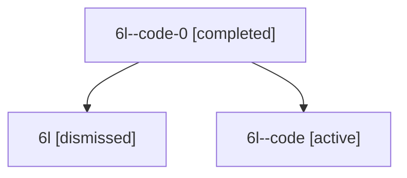

# Session: 6l

[Agent Hoods](../README.md) / [bbugyi200](../users/bbugyi200/README.md) / [athena](../users/bbugyi200/machines/athena/README.md) / [6l](../users/bbugyi200/machines/athena/hoods/6l/README.md) / 6l

Owner: `bbugyi200.athena` · Hood: `6l` · Members: 3

## Lineage

The diagram is an optional enhancement; the ordered table below contains the same lineage in accessible text.

| Role | Agent | State | Model / provider | Timing | Commits | Prompt | Chat |
|---|---|---|---|---|---:|---|---|
| code-0 | 6l--code-0 | completed | gpt-5.6-sol / codex | 2026-07-12T13:33:38.577702+00:00 | 0 | — | [Chat](../agents/bbugyi200.athena.6l--code-0/chat.md) |
| root | 6l | dismissed | claude-fable-5 / claude | 2026-07-12T08:57:51.312901 → 2026-07-12T09:55:25.031380 | 0 | [Prompt](../agents/bbugyi200.athena.6l/prompt.md) | [Chat](../agents/bbugyi200.athena.6l/chat.md) |
| code | 6l--code | active | gpt-5.6-sol / codex | 2026-07-12T13:11:16.496635+00:00 | [1](../agents/bbugyi200.athena.6l--code/README.md#commits) | — | [Chat](../agents/bbugyi200.athena.6l--code/chat.md) |

## Commits

| Role | Repo | Commit | Subject | Committed |
|---|---|---|---|---|
| code | — | `5e84b5b` | fix: preserve validation after lint decoupling | 2026-07-12 09:26:34 EDT |
| — | — | `3b54a7b` | fix: decouple source linting from SASE validation (#225) | 2026-07-12 09:59:47 EDT |
