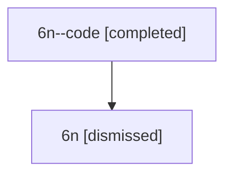

# Session: 6n

[Agent Hoods](../README.md) / [bbugyi200](../users/bbugyi200/README.md) / [athena](../users/bbugyi200/machines/athena/README.md) / [6n](../users/bbugyi200/machines/athena/hoods/6n/README.md) / 6n

Owner: `bbugyi200.athena` · Hood: `6n` · Members: 2

## Lineage

The diagram is an optional enhancement; the ordered table below contains the same lineage in accessible text.

| Role | Agent | State | Model / provider | Timing | Commits | Prompt | Chat |
|---|---|---|---|---|---:|---|---|
| code | 6n--code | completed | gpt-5.6-sol / codex | 2026-07-12T13:54:27.258463+00:00 | [1](../agents/bbugyi200.athena.6n--code/README.md#commits) | — | [Chat](../agents/bbugyi200.athena.6n--code/chat.md) |
| root | 6n | dismissed | claude-fable-5 / claude | 2026-07-12T09:27:36.848941 → 2026-07-12T10:32:17.195775 | 0 | [Prompt](../agents/bbugyi200.athena.6n/prompt.md) | [Chat](../agents/bbugyi200.athena.6n/chat.md) |

## Commits

| Role | Repo | Commit | Subject | Committed |
|---|---|---|---|---|
| — | — | `38d8c73` | chore: Add SDD prompt and plan for worker\_models\_mapping | 2026-06-13 12:50:03 EDT |
| — | — | `51a36b8` | feat!: map worker models by primary lane | 2026-06-13 13:07:39 EDT |
| code | — | `b788ca5` | fix(tui): prevent message pump starvation | 2026-07-12 10:31:55 EDT |
