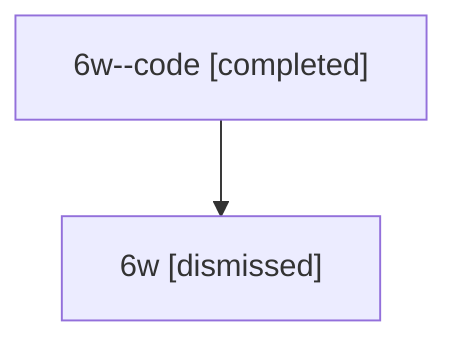

# Session: 6w

[Agent Hoods](../README.md) / [bbugyi200](../users/bbugyi200/README.md) / [athena](../users/bbugyi200/machines/athena/README.md) / [6w](../users/bbugyi200/machines/athena/hoods/6w/README.md) / 6w

Owner: `bbugyi200.athena` · Hood: `6w` · Members: 2

## Lineage

The diagram is an optional enhancement; the ordered table below contains the same lineage in accessible text.

| Role | Agent | State | Model / provider | Timing | Commits | Prompt | Chat |
|---|---|---|---|---|---:|---|---|
| code | 6w--code | completed | gpt-5.6-sol / codex | 2026-07-12T16:43:39.642315+00:00 | [1](../agents/bbugyi200.athena.6w--code/README.md#commits) | — | [Chat](../agents/bbugyi200.athena.6w--code/chat.md) |
| root | 6w | dismissed | claude-fable-5 / claude | 2026-07-12T12:34:30.190143 → 2026-07-12T13:21:08.661345 | 0 | [Prompt](../agents/bbugyi200.athena.6w/prompt.md) | [Chat](../agents/bbugyi200.athena.6w/chat.md) |

## Commits

| Role | Repo | Commit | Subject | Committed |
|---|---|---|---|---|
| — | — | `a7b86be` | chore: Add SDD prompt and plan for hello\_sase\_blog\_nav | 2026-06-13 16:10:45 EDT |
| — | — | `db1043b` | docs(nav): move \[01\] Hello, SASE post under Blog section | 2026-06-13 16:18:50 EDT |
| code | — | `f115c3c` | feat(ace)!: remove file panel trimming | 2026-07-12 13:20:47 EDT |
