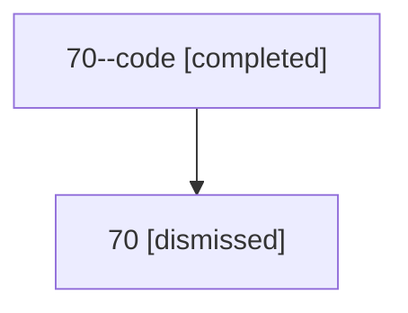

# Session: 70

[Agent Hoods](../README.md) / [bbugyi200](../users/bbugyi200/README.md) / [athena](../users/bbugyi200/machines/athena/README.md) / [70](../users/bbugyi200/machines/athena/hoods/70/README.md) / 70

Owner: `bbugyi200.athena` · Hood: `70` · Members: 2

## Lineage

The diagram is an optional enhancement; the ordered table below contains the same lineage in accessible text.

| Role | Agent | State | Model / provider | Timing | Commits | Prompt | Chat |
|---|---|---|---|---|---:|---|---|
| code | 70--code | completed | gpt-5.6-sol / codex | 2026-07-12T18:45:31.366919+00:00 | [1](../agents/bbugyi200.athena.70--code/README.md#commits) | — | [Chat](../agents/bbugyi200.athena.70--code/chat.md) |
| root | 70 | dismissed | claude-fable-5 / claude | 2026-07-12T14:31:05.356016 → 2026-07-12T15:22:44.405309 | 0 | [Prompt](../agents/bbugyi200.athena.70/prompt.md) | [Chat](../agents/bbugyi200.athena.70/chat.md) |

## Commits

| Role | Repo | Commit | Subject | Committed |
|---|---|---|---|---|
| code | — | `438d3c7` | feat(beads): accelerate companion mutations | 2026-07-12 15:22:26 EDT |
