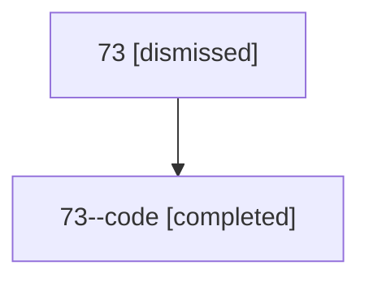

# Session: 73

[Agent Hoods](../README.md) / [bbugyi200](../users/bbugyi200/README.md) / [athena](../users/bbugyi200/machines/athena/README.md) / [73](../users/bbugyi200/machines/athena/hoods/73/README.md) / 73

Owner: `bbugyi200.athena` · Hood: `73` · Members: 2

## Lineage

The diagram is an optional enhancement; the ordered table below contains the same lineage in accessible text.

| Role | Agent | State | Model / provider | Timing | Commits | Prompt | Chat |
|---|---|---|---|---|---:|---|---|
| root | 73 | dismissed | claude-fable-5 / claude | 2026-07-12T15:24:46.488982 → 2026-07-12T15:56:00.341293 | 0 | [Prompt](../agents/bbugyi200.athena.73/prompt.md) | [Chat](../agents/bbugyi200.athena.73/chat.md) |
| code | 73--code | completed | gpt-5.6-sol / codex | 2026-07-12T19:34:41.014090+00:00 | [1](../agents/bbugyi200.athena.73--code/README.md#commits) | — | [Chat](../agents/bbugyi200.athena.73--code/chat.md) |

## Commits

| Role | Repo | Commit | Subject | Committed |
|---|---|---|---|---|
| code | — | `3169f35` | feat(sdd): finalize companion repository changes | 2026-07-12 15:55:45 EDT |
