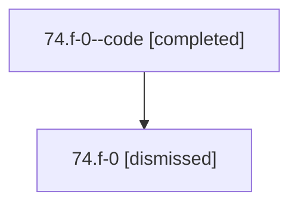

# Session: 74.f-0

[Agent Hoods](../README.md) / [bbugyi200](../users/bbugyi200/README.md) / [athena](../users/bbugyi200/machines/athena/README.md) / [74](../users/bbugyi200/machines/athena/hoods/74/README.md) / 74.f-0

Owner: `bbugyi200.athena` · Hood: `74` · Members: 2

## Lineage

The diagram is an optional enhancement; the ordered table below contains the same lineage in accessible text.

| Role | Agent | State | Model / provider | Timing | Commits | Prompt | Chat |
|---|---|---|---|---|---:|---|---|
| code | 74.f-0--code | completed | gpt-5.6-sol / codex | 2026-07-12T20:08:02.723840+00:00 | [1](../agents/bbugyi200.athena.74.f-0--code/README.md#commits) | — | [Chat](../agents/bbugyi200.athena.74.f-0--code/chat.md) |
| root | 74.f-0 | dismissed | claude-fable-5 / claude | 2026-07-12T15:58:07.701739 → 2026-07-12T16:31:47.428450 | 0 | [Prompt](../agents/bbugyi200.athena.74.f-0/prompt.md) | [Chat](../agents/bbugyi200.athena.74.f-0/chat.md) |

## Commits

| Role | Repo | Commit | Subject | Committed |
|---|---|---|---|---|
| code | — | `19bcf39` | feat: render generated markdown from packaged templates | 2026-07-12 16:31:16 EDT |

## Neighbors

| Agent | Relation | State |
|---|---|---|
| [74](bbugyi200.athena.74.md) (session · 2) | ancestor | completed 1, dismissed 1 |
