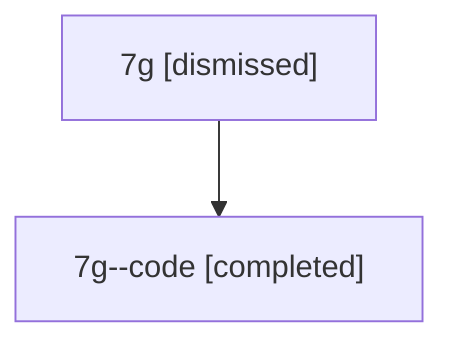

# Session: 7g

[Agent Hoods](../README.md) / [bbugyi200](../users/bbugyi200/README.md) / [athena](../users/bbugyi200/machines/athena/README.md) / [7g](../users/bbugyi200/machines/athena/hoods/7g/README.md) / 7g

Owner: `bbugyi200.athena` · Hood: `7g` · Members: 2

## Lineage

The diagram is an optional enhancement; the ordered table below contains the same lineage in accessible text.

| Role | Agent | State | Model / provider | Timing | Commits | Prompt | Chat |
|---|---|---|---|---|---:|---|---|
| root | 7g | dismissed | claude-fable-5 / claude | 2026-07-13T06:49:10.327586 → 2026-07-13T07:13:31.448550 | 0 | [Prompt](../agents/bbugyi200.athena.7g/prompt.md) | [Chat](../agents/bbugyi200.athena.7g/chat.md) |
| code | 7g--code | completed | gpt-5.6-sol / codex | 2026-07-13T11:03:07.990449+00:00 | 0 | — | [Chat](../agents/bbugyi200.athena.7g--code/chat.md) |

## Commits

| Role | Repo | Commit | Subject | Committed |
|---|---|---|---|---|
| — | — | `b48c65f` | chore: Add SDD prompt and plan for temp\_revert\_agent\_keymap\_fixture\_1 | 2026-06-14 13:12:17 EDT |
| — | — | `806f487` | docs(research): add temporary revert-agent keymap fixture marker | 2026-06-14 13:13:40 EDT |
| — | — | `836d738` | fix: release failed workspaces without visible notifications | 2026-07-13 07:13:16 EDT |
