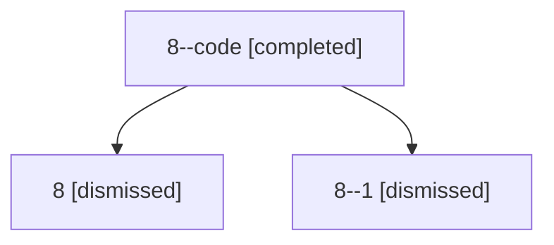

# Session: 8

[Agent Hoods](../README.md) / [bbugyi200](../users/bbugyi200/README.md) / [athena](../users/bbugyi200/machines/athena/README.md) / [8](../users/bbugyi200/machines/athena/hoods/8/README.md) / 8

Owner: `bbugyi200.athena` · Hood: `8` · Members: 3

## Lineage

The diagram is an optional enhancement; the ordered table below contains the same lineage in accessible text.

| Role | Agent | State | Model / provider | Timing | Commits | Prompt | Chat |
|---|---|---|---|---|---:|---|---|
| code | 8--code | completed | gpt-5.5 / codex | 2026-07-06T16:54:08.839555+00:00 | [1](../agents/bbugyi200.athena.8--code/README.md#commits) | — | [Chat](../agents/bbugyi200.athena.8--code/chat.md) |
| root | 8 | dismissed | claude-fable-5 / claude | 2026-07-06T12:41:31.210541 → 2026-07-06T13:05:13.999769 | [1](../agents/bbugyi200.athena.8/README.md#commits) | [Prompt](../agents/bbugyi200.athena.8/prompt.md) | [Chat](../agents/bbugyi200.athena.8/chat.md) |
| 1 | 8--1 | dismissed | claude-fable-5 / claude | 2026-09-10T12:57:17.284130 | 0 | — | — |

## Commits

| Role | Repo | Commit | Subject | Committed |
|---|---|---|---|---|
| — | — | `350c2a3` | fix: guard sase-core-rs source version skew | 2026-06-25 07:11:15 EDT |
| root | — | `f493dbb` | chore: Add SDD prompt and plan for fix\_flaky\_preview\_scroll\_test | 2026-07-06 12:54:07 EDT |
| code | — | `c1475be` | fix(tui): make config preview scrolling deterministic | 2026-07-06 13:04:57 EDT |
