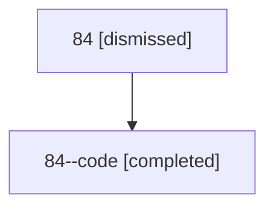

# Session: 84

[Agent Hoods](../README.md) / [bbugyi200](../users/bbugyi200/README.md) / [athena](../users/bbugyi200/machines/athena/README.md) / [84](../users/bbugyi200/machines/athena/hoods/84/README.md) / 84

Owner: `bbugyi200.athena` · Hood: `84` · Members: 2

## Lineage

The diagram is an optional enhancement; the ordered table below contains the same lineage in accessible text.

| Role | Agent | State | Model / provider | Timing | Commits | Prompt | Chat |
|---|---|---|---|---|---:|---|---|
| root | 84 | dismissed | claude-fable-5 / claude | 2026-07-14T05:29:33.569313 → 2026-07-14T06:20:51.757308 | 0 | [Prompt](../agents/bbugyi200.athena.84/prompt.md) | [Chat](../agents/bbugyi200.athena.84/chat.md) |
| code | 84--code | completed | gpt-5.6-sol / codex | 2026-07-14T09:57:12.469501+00:00 | [1](../agents/bbugyi200.athena.84--code/README.md#commits) | — | [Chat](../agents/bbugyi200.athena.84--code/chat.md) |

## Commits

| Role | Repo | Commit | Subject | Committed |
|---|---|---|---|---|
| — | — | `e347407` | chore: Add SDD prompt and plan for rename\_skills\_use | 2026-06-15 16:21:54 EDT |
| — | — | `76a7f0c` | feat(skills)!: rename \`sase skills log\` to \`sase skills use\` | 2026-06-15 16:32:11 EDT |
| code | — | `36b962a` | fix(workspaces): isolate generated SASE repo metadata | 2026-07-14 06:16:37 EDT |

## Neighbors

| Agent | Relation | State |
|---|---|---|
| [84.f1](../agents/bbugyi200.athena.84.f1/README.md) | descendant | completed |
| [84.f2](../agents/bbugyi200.athena.84.f2/README.md) | descendant | completed |
