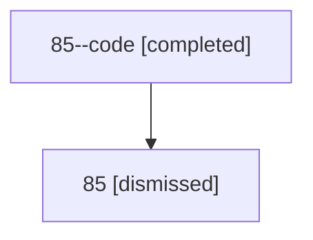

# Session: 85

[Agent Hoods](../README.md) / [bbugyi200](../users/bbugyi200/README.md) / [athena](../users/bbugyi200/machines/athena/README.md) / [85](../users/bbugyi200/machines/athena/hoods/85/README.md) / 85

Owner: `bbugyi200.athena` · Hood: `85` · Members: 2

## Lineage

The diagram is an optional enhancement; the ordered table below contains the same lineage in accessible text.

| Role | Agent | State | Model / provider | Timing | Commits | Prompt | Chat |
|---|---|---|---|---|---:|---|---|
| code | 85--code | completed | gpt-5.6-sol / codex | 2026-07-14T10:50:26.169346+00:00 | [1](../agents/bbugyi200.athena.85--code/README.md#commits) | — | [Chat](../agents/bbugyi200.athena.85--code/chat.md) |
| root | 85 | dismissed | opus / claude | 2026-07-14T06:31:34.236539 → 2026-07-14T07:10:27.114690 | 0 | [Prompt](../agents/bbugyi200.athena.85/prompt.md) | [Chat](../agents/bbugyi200.athena.85/chat.md) |

## Commits

| Role | Repo | Commit | Subject | Committed |
|---|---|---|---|---|
| — | — | `6904833` | chore: Add SDD prompt and plan for rename\_skill\_command | 2026-06-15 17:01:54 EDT |
| — | — | `66d6c68` | feat(cli)!: rename \`sase skills\` command to \`sase skill\` | 2026-06-15 17:39:45 EDT |
| code | — | `b5198f7` | feat(notifications): summarize agent questions in notification modal | 2026-07-14 07:10:00 EDT |
