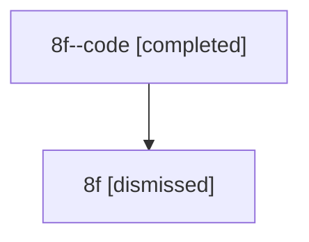

# Session: 8f

[Agent Hoods](../README.md) / [bbugyi200](../users/bbugyi200/README.md) / [athena](../users/bbugyi200/machines/athena/README.md) / [8f](../users/bbugyi200/machines/athena/hoods/8f/README.md) / 8f

Owner: `bbugyi200.athena` · Hood: `8f` · Members: 2

## Lineage

The diagram is an optional enhancement; the ordered table below contains the same lineage in accessible text.

| Role | Agent | State | Model / provider | Timing | Commits | Prompt | Chat |
|---|---|---|---|---|---:|---|---|
| code | 8f--code | completed | gpt-5.6-sol / codex | 2026-07-14T12:55:45.583058+00:00 | [1](../agents/bbugyi200.athena.8f--code/README.md#commits) | — | [Chat](../agents/bbugyi200.athena.8f--code/chat.md) |
| root | 8f | dismissed | claude-fable-5 / claude | 2026-07-14T08:24:29.468328 → 2026-07-14T09:04:50.808954 | 0 | [Prompt](../agents/bbugyi200.athena.8f/prompt.md) | [Chat](../agents/bbugyi200.athena.8f/chat.md) |

## Commits

| Role | Repo | Commit | Subject | Committed |
|---|---|---|---|---|
| — | — | `e20f51f` | chore: Add SDD prompt and plan for remove\_memory\_episodes | 2026-06-15 19:42:22 EDT |
| — | — | `37973b8` | feat(memory)!: remove the memory episodes feature | 2026-06-15 20:16:42 EDT |
| code | — | `fef304c` | fix(ace): prepare project reverts on default branches | 2026-07-14 09:04:35 EDT |
