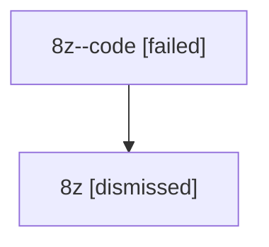

# Session: 8z

[Agent Hoods](../README.md) / [bbugyi200](../users/bbugyi200/README.md) / [athena](../users/bbugyi200/machines/athena/README.md) / [8z](../users/bbugyi200/machines/athena/hoods/8z/README.md) / 8z

Owner: `bbugyi200.athena` · Hood: `8z` · Members: 2

## Lineage

The diagram is an optional enhancement; the ordered table below contains the same lineage in accessible text.

| Role | Agent | State | Model / provider | Timing | Commits | Prompt | Chat |
|---|---|---|---|---|---:|---|---|
| code | 8z--code | failed | gpt-5.6-sol / codex | 2026-07-15T13:01:18.872793+00:00 | [1](../agents/bbugyi200.athena.8z--code/README.md#commits) | — | — |
| root | 8z | dismissed | gpt-5.6-sol / codex | 2026-07-15T08:58:01.075689 | 0 | [Prompt](../agents/bbugyi200.athena.8z/prompt.md) | [Chat](../agents/bbugyi200.athena.8z/chat.md) |

## Commits

| Role | Repo | Commit | Subject | Committed |
|---|---|---|---|---|
| — | — | `391043f` | chore: Add SDD prompt and plan for xprompts\_metadata\_field | 2026-06-16 14:08:36 EDT |
| — | — | `0374375` | feat: capture xprompt usage metadata | 2026-06-16 14:31:17 EDT |
| code | — | `ea38782` | fix: display configured project names in plan inventory | 2026-07-15 09:10:11 EDT |
