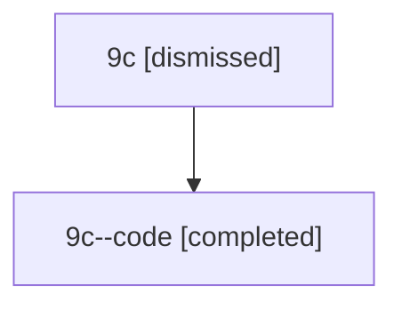

# Session: 9c

[Agent Hoods](../README.md) / [bbugyi200](../users/bbugyi200/README.md) / [athena](../users/bbugyi200/machines/athena/README.md) / [9c](../users/bbugyi200/machines/athena/hoods/9c/README.md) / 9c

Owner: `bbugyi200.athena` · Hood: `9c` · Members: 2

## Lineage

The diagram is an optional enhancement; the ordered table below contains the same lineage in accessible text.

| Role | Agent | State | Model / provider | Timing | Commits | Prompt | Chat |
|---|---|---|---|---|---:|---|---|
| root | 9c | dismissed | gpt-5.6-sol / codex | 2026-07-15T12:53:52.438580 → 2026-07-15T13:33:44.130671 | 0 | [Prompt](../agents/bbugyi200.athena.9c/prompt.md) | [Chat](../agents/bbugyi200.athena.9c/chat.md) |
| code | 9c--code | completed | gpt-5.6-sol / codex | 2026-07-15T17:04:08.281430+00:00 | [1](../agents/bbugyi200.athena.9c--code/README.md#commits) | — | [Chat](../agents/bbugyi200.athena.9c--code/chat.md) |

## Commits

| Role | Repo | Commit | Subject | Committed |
|---|---|---|---|---|
| — | — | `29d7793` | chore: Add SDD prompt and plan for ace\_tui\_fetch\_png\_diff\_crash | 2026-06-17 08:12:15 EDT |
| — | — | `d4f25bc` | fix(tui): stop treating path-typed workflow outputs as diffs | 2026-06-17 08:28:25 EDT |
| code | — | `0a124f7` | fix: release runner slots while awaiting answers | 2026-07-15 13:32:49 EDT |

## Neighbors

| Agent | Relation | State |
|---|---|---|
| [9c.f0](bbugyi200.athena.9c.f0.md) (session · 2) | descendant | completed 1, dismissed 1 |
