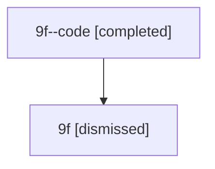

# Session: 9f

[Agent Hoods](../README.md) / [bbugyi200](../users/bbugyi200/README.md) / [athena](../users/bbugyi200/machines/athena/README.md) / [9f](../users/bbugyi200/machines/athena/hoods/9f/README.md) / 9f

Owner: `bbugyi200.athena` · Hood: `9f` · Members: 2

## Lineage

The diagram is an optional enhancement; the ordered table below contains the same lineage in accessible text.

| Role | Agent | State | Model / provider | Timing | Commits | Prompt | Chat |
|---|---|---|---|---|---:|---|---|
| code | 9f--code | completed | gpt-5.6-sol / codex | 2026-07-15T17:47:32.115677+00:00 | [1](../agents/bbugyi200.athena.9f--code/README.md#commits) | — | [Chat](../agents/bbugyi200.athena.9f--code/chat.md) |
| root | 9f | dismissed | gpt-5.6-sol / codex | 2026-07-15T13:31:26.794327 → 2026-07-15T14:13:56.242826 | 0 | [Prompt](../agents/bbugyi200.athena.9f/prompt.md) | [Chat](../agents/bbugyi200.athena.9f/chat.md) |

## Commits

| Role | Repo | Commit | Subject | Committed |
|---|---|---|---|---|
| — | — | `1607d60` | chore: Add SDD prompt and plan for xprompt\_part\_color | 2026-06-17 10:24:01 EDT |
| — | — | `7531efc` | feat(tui): use distinct color for xprompt part values | 2026-06-17 10:30:55 EDT |
| code | — | `805de8f` | test: harden CI reliability harnesses | 2026-07-15 14:13:42 EDT |
