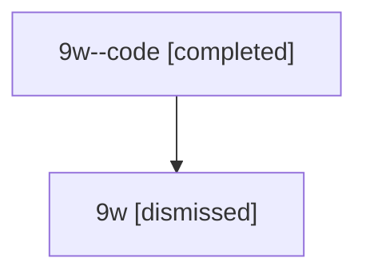

# Session: 9w

[Agent Hoods](../README.md) / [bbugyi200](../users/bbugyi200/README.md) / [athena](../users/bbugyi200/machines/athena/README.md) / [9w](../users/bbugyi200/machines/athena/hoods/9w/README.md) / 9w

Owner: `bbugyi200.athena` · Hood: `9w` · Members: 2

## Lineage

The diagram is an optional enhancement; the ordered table below contains the same lineage in accessible text.

| Role | Agent | State | Model / provider | Timing | Commits | Prompt | Chat |
|---|---|---|---|---|---:|---|---|
| code | 9w--code | completed | gpt-5.6-sol / codex | 2026-07-15T22:29:41.636211+00:00 | [1](../agents/bbugyi200.athena.9w--code/README.md#commits) | — | [Chat](../agents/bbugyi200.athena.9w--code/chat.md) |
| root | 9w | dismissed | gpt-5.6-sol / codex | 2026-07-15T18:23:35.083592 → 2026-07-15T18:51:06.095756 | 0 | [Prompt](../agents/bbugyi200.athena.9w/prompt.md) | [Chat](../agents/bbugyi200.athena.9w/chat.md) |

## Commits

| Role | Repo | Commit | Subject | Committed |
|---|---|---|---|---|
| — | — | `98ed259` | chore: Add SDD prompt and plan for telegram\_plan\_reject\_kill | 2026-06-17 17:49:24 EDT |
| — | — | `29a6748` | chore: Mark SDD plan done | 2026-06-17 18:13:53 EDT |
| code | — | `728595e` | fix(tui): compact agent metadata sections | 2026-07-15 18:50:48 EDT |
