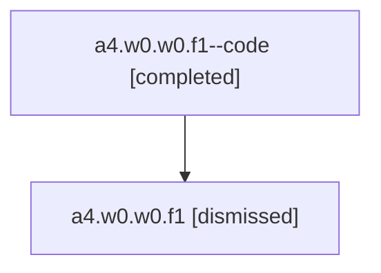

# Session: a4.w0.w0.f1

[Agent Hoods](../README.md) / [bbugyi200](../users/bbugyi200/README.md) / [athena](../users/bbugyi200/machines/athena/README.md) / [a4](../users/bbugyi200/machines/athena/hoods/a4/README.md) / a4.w0.w0.f1

Owner: `bbugyi200.athena` · Hood: `a4` · Members: 2

## Lineage

The diagram is an optional enhancement; the ordered table below contains the same lineage in accessible text.

| Role | Agent | State | Model / provider | Timing | Commits | Prompt | Chat |
|---|---|---|---|---|---:|---|---|
| code | a4.w0.w0.f1--code | completed | gpt-5.6-sol / codex | 2026-07-16T12:07:41.832645+00:00 | [1](../agents/bbugyi200.athena.a4.w0.w0.f1--code/README.md#commits) | — | [Chat](../agents/bbugyi200.athena.a4.w0.w0.f1--code/chat.md) |
| root | a4.w0.w0.f1 | dismissed | gpt-5.6-sol / codex | 2026-07-16T08:04:51.061684 → 2026-07-16T08:23:56.119672 | 0 | [Prompt](../agents/bbugyi200.athena.a4.w0.w0.f1/prompt.md) | [Chat](../agents/bbugyi200.athena.a4.w0.w0.f1/chat.md) |

## Commits

| Role | Repo | Commit | Subject | Committed |
|---|---|---|---|---|
| code | — | `42cadf4` | feat(tui): underline available plan titles | 2026-07-16 08:23:43 EDT |

## Neighbors

| Agent | Relation | State |
|---|---|---|
| [a4.w0.w0](bbugyi200.athena.a4.w0.w0.md) (session · 2) | ancestor | completed 1, dismissed 1 |
| [a4.w0](bbugyi200.athena.a4.w0.md) (session · 2) | ancestor | completed 1, dismissed 1 |
| [a4](bbugyi200.athena.a4.md) (session · 2) | ancestor | completed 1, dismissed 1 |
| [a4.w0.w0.f1.f0](../agents/bbugyi200.athena.a4.w0.w0.f1.f0/README.md) | descendant | dismissed |
| [a4.w0.w0.f0](bbugyi200.athena.a4.w0.w0.f0.md) (session · 2) | a4.w0.w0 hood | completed 1, dismissed 1 |
