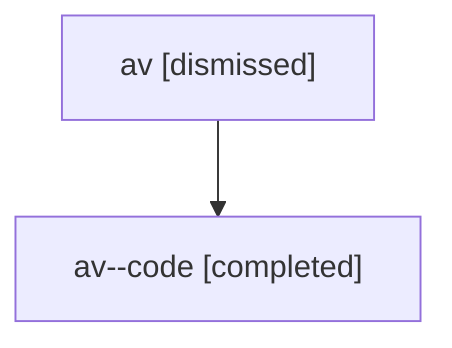

# Session: av

[Agent Hoods](../README.md) / [bbugyi200](../users/bbugyi200/README.md) / [athena](../users/bbugyi200/machines/athena/README.md) / [av](../users/bbugyi200/machines/athena/hoods/av/README.md) / av

Owner: `bbugyi200.athena` · Hood: `av` · Members: 2

## Lineage

The diagram is an optional enhancement; the ordered table below contains the same lineage in accessible text.

| Role | Agent | State | Model / provider | Timing | Commits | Prompt | Chat |
|---|---|---|---|---|---:|---|---|
| root | av | dismissed | gpt-5.6-sol / codex | 2026-07-16T16:12:39.493052 → 2026-07-16T16:47:37.909941 | 0 | [Prompt](../agents/bbugyi200.athena.av/prompt.md) | [Chat](../agents/bbugyi200.athena.av/chat.md) |
| code | av--code | completed | gpt-5.6-sol / codex | 2026-07-16T20:17:18.244652+00:00 | [1](../agents/bbugyi200.athena.av--code/README.md#commits) | — | [Chat](../agents/bbugyi200.athena.av--code/chat.md) |

## Commits

| Role | Repo | Commit | Subject | Committed |
|---|---|---|---|---|
| code | — | `4d2fb87` | fix(tui): improve inline code visibility | 2026-07-16 16:47:24 EDT |
