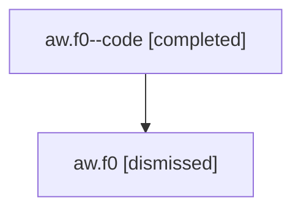

# Session: aw.f0

[Agent Hoods](../README.md) / [bbugyi200](../users/bbugyi200/README.md) / [athena](../users/bbugyi200/machines/athena/README.md) / [aw](../users/bbugyi200/machines/athena/hoods/aw/README.md) / aw.f0

Owner: `bbugyi200.athena` · Hood: `aw` · Members: 2

## Lineage

The diagram is an optional enhancement; the ordered table below contains the same lineage in accessible text.

| Role | Agent | State | Model / provider | Timing | Commits | Prompt | Chat |
|---|---|---|---|---|---:|---|---|
| code | aw.f0--code | completed | gpt-5.6-sol / codex | 2026-07-16T21:13:04.654719+00:00 | [1](../agents/bbugyi200.athena.aw.f0--code/README.md#commits) | — | [Chat](../agents/bbugyi200.athena.aw.f0--code/chat.md) |
| root | aw.f0 | dismissed | opus / claude | 2026-07-16T17:03:10.369847 → 2026-07-16T17:24:00.861362 | 0 | [Prompt](../agents/bbugyi200.athena.aw.f0/prompt.md) | [Chat](../agents/bbugyi200.athena.aw.f0/chat.md) |

## Commits

| Role | Repo | Commit | Subject | Committed |
|---|---|---|---|---|
| code | — | `77b92ac` | fix(ace): highlight code in xprompt-led lines | 2026-07-16 17:23:48 EDT |

## Neighbors

| Agent | Relation | State |
|---|---|---|
| [aw](bbugyi200.athena.aw.md) (session · 2) | ancestor | completed 1, dismissed 1 |
