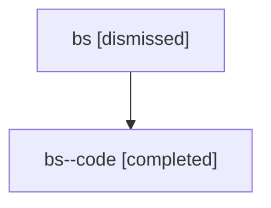

# Session: bs

[Agent Hoods](../README.md) / [bbugyi200](../users/bbugyi200/README.md) / [athena](../users/bbugyi200/machines/athena/README.md) / [bs](../users/bbugyi200/machines/athena/hoods/bs/README.md) / bs

Owner: `bbugyi200.athena` · Hood: `bs` · Members: 2

## Lineage

The diagram is an optional enhancement; the ordered table below contains the same lineage in accessible text.

| Role | Agent | State | Model / provider | Timing | Commits | Prompt | Chat |
|---|---|---|---|---|---:|---|---|
| root | bs | dismissed | gpt-5.6-sol / codex | 2026-07-17T08:58:18.410654 → 2026-07-17T09:14:38.522283 | 0 | [Prompt](../agents/bbugyi200.athena.bs/prompt.md) | [Chat](../agents/bbugyi200.athena.bs/chat.md) |
| code | bs--code | completed | gpt-5.6-sol / codex | 2026-07-17T13:02:18.432981+00:00 | [1](../agents/bbugyi200.athena.bs--code/README.md#commits) | — | [Chat](../agents/bbugyi200.athena.bs--code/chat.md) |

## Commits

| Role | Repo | Commit | Subject | Committed |
|---|---|---|---|---|
| code | — | `b7b64b7` | feat(ace): place artifacts directly below plan | 2026-07-17 09:14:23 EDT |
