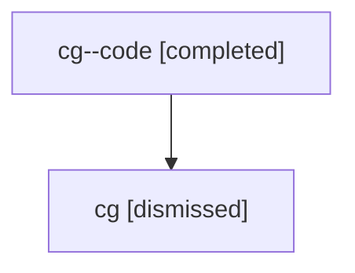

# Session: cg

[Agent Hoods](../README.md) / [bbugyi200](../users/bbugyi200/README.md) / [athena](../users/bbugyi200/machines/athena/README.md) / [cg](../users/bbugyi200/machines/athena/hoods/cg/README.md) / cg

Owner: `bbugyi200.athena` · Hood: `cg` · Members: 2

## Lineage

The diagram is an optional enhancement; the ordered table below contains the same lineage in accessible text.

| Role | Agent | State | Model / provider | Timing | Commits | Prompt | Chat |
|---|---|---|---|---|---:|---|---|
| code | cg--code | completed | gpt-5.6-sol / codex | 2026-07-17T19:21:09.797459+00:00 | [1](../agents/bbugyi200.athena.cg--code/README.md#commits) | — | [Chat](../agents/bbugyi200.athena.cg--code/chat.md) |
| root | cg | dismissed | gpt-5.6-sol / codex | 2026-07-17T15:09:03.668926 → 2026-07-17T16:00:13.396493 | 0 | [Prompt](../agents/bbugyi200.athena.cg/prompt.md) | [Chat](../agents/bbugyi200.athena.cg/chat.md) |

## Commits

| Role | Repo | Commit | Subject | Committed |
|---|---|---|---|---|
| code | — | `f678228` | fix(sdd): make sidecar integration transactional | 2026-07-17 15:59:57 EDT |
