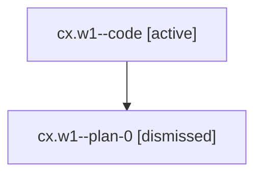

# Session: cx.w1

[Agent Hoods](../README.md) / [bbugyi200](../users/bbugyi200/README.md) / [athena](../users/bbugyi200/machines/athena/README.md) / [cx](../users/bbugyi200/machines/athena/hoods/cx/README.md) / cx.w1

Owner: `bbugyi200.athena` · Hood: `cx` · Members: 2

## Lineage

The diagram is an optional enhancement; the ordered table below contains the same lineage in accessible text.

| Role | Agent | State | Model / provider | Timing | Commits | Prompt | Chat |
|---|---|---|---|---|---:|---|---|
| code | cx.w1--code | active | gpt-5.6-sol / codex | 2026-07-18T11:24:41.447907+00:00 | 0 | — | — |
| plan-0 | cx.w1--plan-0 | dismissed | gpt-5.6-sol / codex | 2026-07-18T07:09:28.561842 | 0 | [Prompt](../agents/bbugyi200.athena.cx.w1--plan-0/prompt.md) | [Chat](../agents/bbugyi200.athena.cx.w1--plan-0/chat.md) |

## Neighbors

| Agent | Relation | State |
|---|---|---|
| [cx](bbugyi200.athena.cx.md) (session · 2) | ancestor | completed 1, dismissed 1 |
| [cx.f0](bbugyi200.athena.cx.f0.md) (session · 2) | cx hood | completed 1, dismissed 1 |
| [cx.w0.w0](../agents/bbugyi200.athena.cx.w0.w0/README.md) | cx hood | dismissed |
| [cx.w0.w1.w0](../agents/bbugyi200.athena.cx.w0.w1.w0/README.md) | cx hood | dismissed |
| [cx.w0.w2](../agents/bbugyi200.athena.cx.w0.w2/README.md) | cx hood | dismissed |
