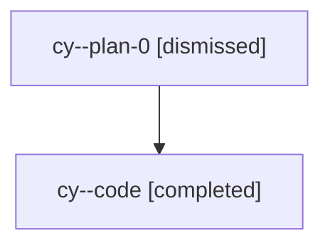

# Session: cy

[Agent Hoods](../README.md) / [bbugyi200](../users/bbugyi200/README.md) / [athena](../users/bbugyi200/machines/athena/README.md) / [cy](../users/bbugyi200/machines/athena/hoods/cy/README.md) / cy

Owner: `bbugyi200.athena` · Hood: `cy` · Members: 2

## Lineage

The diagram is an optional enhancement; the ordered table below contains the same lineage in accessible text.

| Role | Agent | State | Model / provider | Timing | Commits | Prompt | Chat |
|---|---|---|---|---|---:|---|---|
| plan-0 | cy--plan-0 | dismissed | claude-fable-5 / claude | 2026-07-18T06:35:38.864493 → 2026-07-18T07:07:36.957821 | 0 | [Prompt](../agents/bbugyi200.athena.cy--plan-0/prompt.md) | [Chat](../agents/bbugyi200.athena.cy--plan-0/chat.md) |
| code | cy--code | completed | gpt-5.6-sol / codex | 2026-07-18T10:49:04.610085+00:00 | [1](../agents/bbugyi200.athena.cy--code/README.md#commits) | — | [Chat](../agents/bbugyi200.athena.cy--code/chat.md) |

## Commits

| Role | Repo | Commit | Subject | Committed |
|---|---|---|---|---|
| code | — | `4dff939` | perf(ace): bound plain diff rendering | 2026-07-18 07:07:15 EDT |
