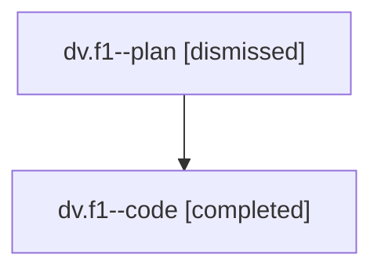

# Session: dv.f1

[Agent Hoods](../README.md) / [bbugyi200](../users/bbugyi200/README.md) / [athena](../users/bbugyi200/machines/athena/README.md) / [dv](../users/bbugyi200/machines/athena/hoods/dv/README.md) / dv.f1

Owner: `bbugyi200.athena` · Hood: `dv` · Members: 2

## Lineage

The diagram is an optional enhancement; the ordered table below contains the same lineage in accessible text.

| Role | Agent | State | Model / provider | Timing | Commits | Prompt | Chat |
|---|---|---|---|---|---:|---|---|
| plan | dv.f1--plan | dismissed | claude-fable-5 / claude | 2026-07-18T16:03:16.532400 → 2026-07-18T16:58:58.009860 | 0 | [Prompt](../agents/bbugyi200.athena.dv.f1--plan/prompt.md) | [Chat](../agents/bbugyi200.athena.dv.f1--plan/chat.md) |
| code | dv.f1--code | completed | gpt-5.6-sol / codex | 2026-07-18T20:26:44.481361+00:00 | [1](../agents/bbugyi200.athena.dv.f1--code/README.md#commits) | — | [Chat](../agents/bbugyi200.athena.dv.f1--code/chat.md) |

## Commits

| Role | Repo | Commit | Subject | Committed |
|---|---|---|---|---|
| code | — | `ff19c80` | feat(ace): sort clan members by status | 2026-07-18 16:58:45 EDT |

## Neighbors

| Agent | Relation | State |
|---|---|---|
| [dv](bbugyi200.athena.dv.md) (session · 2) | ancestor | completed 1, dismissed 1 |
| [dv.f0](../agents/bbugyi200.athena.dv.f0/README.md) | dv hood | dismissed |
