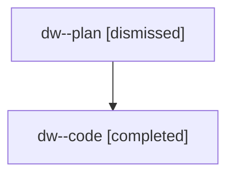

# Session: dw

[Agent Hoods](../README.md) / [bbugyi200](../users/bbugyi200/README.md) / [athena](../users/bbugyi200/machines/athena/README.md) / [dw](../users/bbugyi200/machines/athena/hoods/dw/README.md) / dw

Owner: `bbugyi200.athena` · Hood: `dw` · Members: 2

## Lineage

The diagram is an optional enhancement; the ordered table below contains the same lineage in accessible text.

| Role | Agent | State | Model / provider | Timing | Commits | Prompt | Chat |
|---|---|---|---|---|---:|---|---|
| plan | dw--plan | dismissed | gpt-5.6-sol / codex | 2026-07-18T16:51:15.698123 → 2026-07-18T17:17:13.320388 | 0 | [Prompt](../agents/bbugyi200.athena.dw--plan/prompt.md) | [Chat](../agents/bbugyi200.athena.dw--plan/chat.md) |
| code | dw--code | completed | gpt-5.6-sol / codex | 2026-07-18T21:04:02.542766+00:00 | [1](../agents/bbugyi200.athena.dw--code/README.md#commits) | — | [Chat](../agents/bbugyi200.athena.dw--code/chat.md) |

## Commits

| Role | Repo | Commit | Subject | Committed |
|---|---|---|---|---|
| code | — | `97583b6` | feat(ace): share prompt search register across panes | 2026-07-18 17:16:58 EDT |
