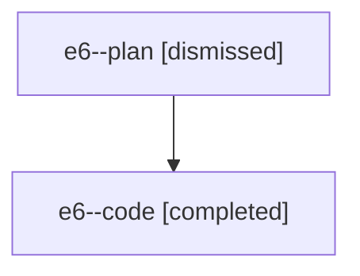

# Session: e6

[Agent Hoods](../README.md) / [bbugyi200](../users/bbugyi200/README.md) / [athena](../users/bbugyi200/machines/athena/README.md) / [e6](../users/bbugyi200/machines/athena/hoods/e6/README.md) / e6

Owner: `bbugyi200.athena` · Hood: `e6` · Members: 2

## Lineage

The diagram is an optional enhancement; the ordered table below contains the same lineage in accessible text.

| Role | Agent | State | Model / provider | Timing | Commits | Prompt | Chat |
|---|---|---|---|---|---:|---|---|
| plan | e6--plan | dismissed | claude-fable-5 / claude | 2026-07-18T20:32:21.843661 → 2026-07-18T21:03:28.744171 | 0 | [Prompt](../agents/bbugyi200.athena.e6--plan/prompt.md) | [Chat](../agents/bbugyi200.athena.e6--plan/chat.md) |
| code | e6--code | completed | gpt-5.6-sol / codex | 2026-07-19T00:40:51.377888+00:00 | 0 | — | [Chat](../agents/bbugyi200.athena.e6--code/chat.md) |

## Commits

| Role | Repo | Commit | Subject | Committed |
|---|---|---|---|---|
| — | — | `a705f79` | feat(tui): expand agent neighbor hood closure | 2026-07-18 21:02:54 EDT |

## Neighbors

| Agent | Relation | State |
|---|---|---|
| [e6.6.verify](../agents/bbugyi200.athena.e6.6.verify/README.md) | descendant | failed |
| [e6.f1](bbugyi200.athena.e6.f1.md) (session · 2) | descendant | completed 1, dismissed 1 |
