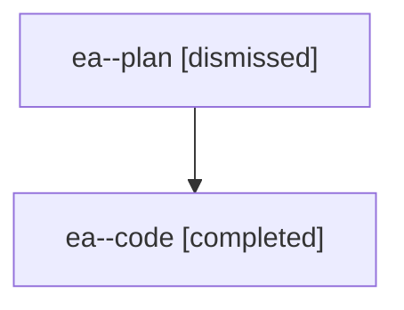

# Session: ea

[Agent Hoods](../README.md) / [bbugyi200](../users/bbugyi200/README.md) / [athena](../users/bbugyi200/machines/athena/README.md) / [ea](../users/bbugyi200/machines/athena/hoods/ea/README.md) / ea

Owner: `bbugyi200.athena` · Hood: `ea` · Members: 2

## Lineage

The diagram is an optional enhancement; the ordered table below contains the same lineage in accessible text.

| Role | Agent | State | Model / provider | Timing | Commits | Prompt | Chat |
|---|---|---|---|---|---:|---|---|
| plan | ea--plan | dismissed | claude-fable-5 / claude | 2026-07-19T07:11:00.489422 → 2026-07-19T07:50:55.260099 | 0 | [Prompt](../agents/bbugyi200.athena.ea--plan/prompt.md) | [Chat](../agents/bbugyi200.athena.ea--plan/chat.md) |
| code | ea--code | completed | gpt-5.6-sol / codex | 2026-07-19T11:25:08.577577+00:00 | [1](../agents/bbugyi200.athena.ea--code/README.md#commits) | — | [Chat](../agents/bbugyi200.athena.ea--code/chat.md) |

## Commits

| Role | Repo | Commit | Subject | Committed |
|---|---|---|---|---|
| code | — | `e2a294d` | fix(axe): prevent recurring chop collision storms | 2026-07-19 07:50:41 EDT |
