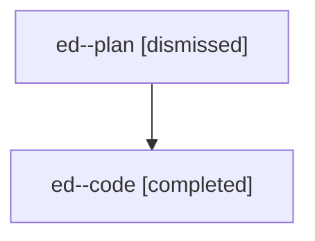

# Session: ed

[Agent Hoods](../README.md) / [bbugyi200](../users/bbugyi200/README.md) / [athena](../users/bbugyi200/machines/athena/README.md) / [ed](../users/bbugyi200/machines/athena/hoods/ed/README.md) / ed

Owner: `bbugyi200.athena` · Hood: `ed` · Members: 2

## Lineage

The diagram is an optional enhancement; the ordered table below contains the same lineage in accessible text.

| Role | Agent | State | Model / provider | Timing | Commits | Prompt | Chat |
|---|---|---|---|---|---:|---|---|
| plan | ed--plan | dismissed | gpt-5.6-sol / codex | 2026-07-19T07:24:11.859569 → 2026-07-19T08:04:47.408291 | 0 | [Prompt](../agents/bbugyi200.athena.ed--plan/prompt.md) | [Chat](../agents/bbugyi200.athena.ed--plan/chat.md) |
| code | ed--code | completed | gpt-5.6-sol / codex | 2026-07-19T11:31:27.436779+00:00 | [1](../agents/bbugyi200.athena.ed--code/README.md#commits) | — | [Chat](../agents/bbugyi200.athena.ed--code/chat.md) |

## Commits

| Role | Repo | Commit | Subject | Committed |
|---|---|---|---|---|
| code | — | `9f6c8f1` | feat(ace): add direct numeric fold levels | 2026-07-19 08:04:15 EDT |
