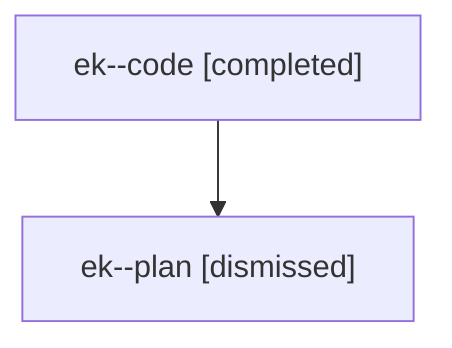

# Session: ek

[Agent Hoods](../README.md) / [bbugyi200](../users/bbugyi200/README.md) / [athena](../users/bbugyi200/machines/athena/README.md) / [ek](../users/bbugyi200/machines/athena/hoods/ek/README.md) / ek

Owner: `bbugyi200.athena` · Hood: `ek` · Members: 2

## Lineage

The diagram is an optional enhancement; the ordered table below contains the same lineage in accessible text.

| Role | Agent | State | Model / provider | Timing | Commits | Prompt | Chat |
|---|---|---|---|---|---:|---|---|
| code | ek--code | completed | gpt-5.6-sol / codex | 2026-07-19T12:24:25.627320+00:00 | [1](../agents/bbugyi200.athena.ek--code/README.md#commits) | — | [Chat](../agents/bbugyi200.athena.ek--code/chat.md) |
| plan | ek--plan | dismissed | gpt-5.6-sol / codex | 2026-07-19T08:16:07.206428 → 2026-07-19T08:45:28.468689 | 0 | [Prompt](../agents/bbugyi200.athena.ek--plan/prompt.md) | [Chat](../agents/bbugyi200.athena.ek--plan/chat.md) |

## Commits

| Role | Repo | Commit | Subject | Committed |
|---|---|---|---|---|
| code | — | `5868154` | fix(ace): descend from tribe focus on agent jumps | 2026-07-19 08:44:50 EDT |
