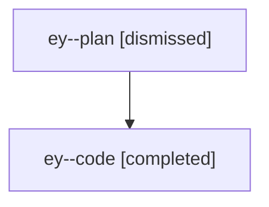

# Session: ey

[Agent Hoods](../README.md) / [bbugyi200](../users/bbugyi200/README.md) / [athena](../users/bbugyi200/machines/athena/README.md) / [ey](../users/bbugyi200/machines/athena/hoods/ey/README.md) / ey

Owner: `bbugyi200.athena` · Hood: `ey` · Members: 2

## Lineage

The diagram is an optional enhancement; the ordered table below contains the same lineage in accessible text.

| Role | Agent | State | Model / provider | Timing | Commits | Prompt | Chat |
|---|---|---|---|---|---:|---|---|
| plan | ey--plan | dismissed | gpt-5.6-sol / codex | 2026-07-19T10:13:07.084211 → 2026-07-19T11:33:22.531648 | 0 | [Prompt](../agents/bbugyi200.athena.ey--plan/prompt.md) | [Chat](../agents/bbugyi200.athena.ey--plan/chat.md) |
| code | ey--code | completed | gpt-5.6-sol / codex | 2026-07-19T14:19:43.540501+00:00 | [1](../agents/bbugyi200.athena.ey--code/README.md#commits) | — | [Chat](../agents/bbugyi200.athena.ey--code/chat.md) |

## Commits

| Role | Repo | Commit | Subject | Committed |
|---|---|---|---|---|
| code | — | `e62eefb` | feat(ace): support two-character jump hints | 2026-07-19 11:33:06 EDT |
