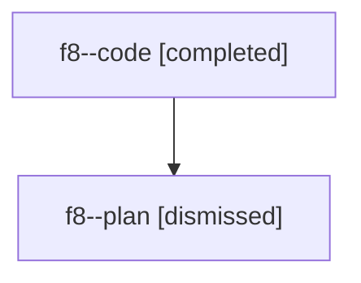

# Session: f8

[Agent Hoods](../README.md) / [bbugyi200](../users/bbugyi200/README.md) / [athena](../users/bbugyi200/machines/athena/README.md) / [f8](../users/bbugyi200/machines/athena/hoods/f8/README.md) / f8

Owner: `bbugyi200.athena` · Hood: `f8` · Members: 2

## Lineage

The diagram is an optional enhancement; the ordered table below contains the same lineage in accessible text.

| Role | Agent | State | Model / provider | Timing | Commits | Prompt | Chat |
|---|---|---|---|---|---:|---|---|
| code | f8--code | completed | gpt-5.6-sol / codex | 2026-07-19T18:02:08.508892+00:00 | [1](../agents/bbugyi200.athena.f8--code/README.md#commits) | — | [Chat](../agents/bbugyi200.athena.f8--code/chat.md) |
| plan | f8--plan | dismissed | claude-fable-5 / claude | 2026-07-19T13:53:14.893716 → 2026-07-19T14:23:16.405512 | 0 | [Prompt](../agents/bbugyi200.athena.f8--plan/prompt.md) | [Chat](../agents/bbugyi200.athena.f8--plan/chat.md) |

## Commits

| Role | Repo | Commit | Subject | Committed |
|---|---|---|---|---|
| code | — | `918e3b9` | feat(tui): show clan member status in wait metadata | 2026-07-19 14:23:01 EDT |
