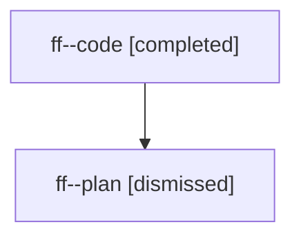

# Session: ff

[Agent Hoods](../README.md) / [bbugyi200](../users/bbugyi200/README.md) / [athena](../users/bbugyi200/machines/athena/README.md) / [ff](../users/bbugyi200/machines/athena/hoods/ff/README.md) / ff

Owner: `bbugyi200.athena` · Hood: `ff` · Members: 2

## Lineage

The diagram is an optional enhancement; the ordered table below contains the same lineage in accessible text.

| Role | Agent | State | Model / provider | Timing | Commits | Prompt | Chat |
|---|---|---|---|---|---:|---|---|
| code | ff--code | completed | gpt-5.6-sol / codex | 2026-07-19T21:26:49.567286+00:00 | [1](../agents/bbugyi200.athena.ff--code/README.md#commits) | — | [Chat](../agents/bbugyi200.athena.ff--code/chat.md) |
| plan | ff--plan | dismissed | gpt-5.6-sol / codex | 2026-07-19T17:18:10.741782 → 2026-07-19T17:57:15.145009 | 0 | [Prompt](../agents/bbugyi200.athena.ff--plan/prompt.md) | [Chat](../agents/bbugyi200.athena.ff--plan/chat.md) |

## Commits

| Role | Repo | Commit | Subject | Committed |
|---|---|---|---|---|
| code | — | `b938e94` | feat(tui): navigate to neighbors in folded clans | 2026-07-19 17:56:58 EDT |
