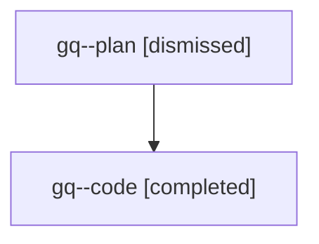

# Session: gq

[Agent Hoods](../README.md) / [bbugyi200](../users/bbugyi200/README.md) / [athena](../users/bbugyi200/machines/athena/README.md) / [gq](../users/bbugyi200/machines/athena/hoods/gq/README.md) / gq

Owner: `bbugyi200.athena` · Hood: `gq` · Members: 2

## Lineage

The diagram is an optional enhancement; the ordered table below contains the same lineage in accessible text.

| Role | Agent | State | Model / provider | Timing | Commits | Prompt | Chat |
|---|---|---|---|---|---:|---|---|
| plan | gq--plan | dismissed | gpt-5.6-sol / codex | 2026-07-21T07:39:53.988673 → 2026-07-21T07:56:54.843926 | 0 | [Prompt](../agents/bbugyi200.athena.gq--plan/prompt.md) | [Chat](../agents/bbugyi200.athena.gq--plan/chat.md) |
| code | gq--code | completed | gpt-5.6-sol / codex | 2026-07-21T11:44:15.033165+00:00 | [1](../agents/bbugyi200.athena.gq--code/README.md#commits) | — | [Chat](../agents/bbugyi200.athena.gq--code/chat.md) |

## Commits

| Role | Repo | Commit | Subject | Committed |
|---|---|---|---|---|
| code | — | `fdbdf2d` | feat(statistics): add reverse time range cycling | 2026-07-21 07:56:41 EDT |
