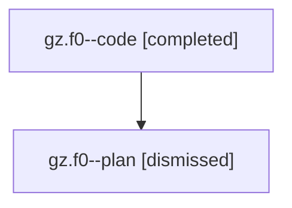

# Session: gz.f0

[Agent Hoods](../README.md) / [bbugyi200](../users/bbugyi200/README.md) / [athena](../users/bbugyi200/machines/athena/README.md) / [gz](../users/bbugyi200/machines/athena/hoods/gz/README.md) / gz.f0

Owner: `bbugyi200.athena` · Hood: `gz` · Members: 2

## Lineage

The diagram is an optional enhancement; the ordered table below contains the same lineage in accessible text.

| Role | Agent | State | Model / provider | Timing | Commits | Prompt | Chat |
|---|---|---|---|---|---:|---|---|
| code | gz.f0--code | completed | gpt-5.6-sol / codex | 2026-07-21T14:54:42.936618+00:00 | [1](../agents/bbugyi200.athena.gz.f0--code/README.md#commits) | — | [Chat](../agents/bbugyi200.athena.gz.f0--code/chat.md) |
| plan | gz.f0--plan | dismissed | gpt-5.6-sol / codex | 2026-07-21T10:49:43.013894 → 2026-07-21T11:47:00.318490 | 0 | [Prompt](../agents/bbugyi200.athena.gz.f0--plan/prompt.md) | [Chat](../agents/bbugyi200.athena.gz.f0--plan/chat.md) |

## Commits

| Role | Repo | Commit | Subject | Committed |
|---|---|---|---|---|
| code | — | `f9837f7` | feat(sdd): render artifact links as Markdown bullets | 2026-07-21 11:46:37 EDT |

## Neighbors

| Agent | Relation | State |
|---|---|---|
| [gz](bbugyi200.athena.gz.md) (session · 2) | ancestor | completed 1, dismissed 1 |
