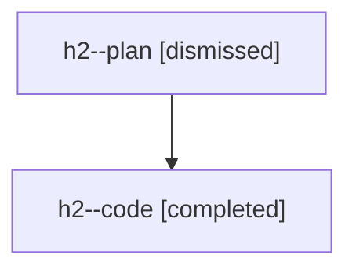

# Session: h2

[Agent Hoods](../README.md) / [bbugyi200](../users/bbugyi200/README.md) / [athena](../users/bbugyi200/machines/athena/README.md) / [h2](../users/bbugyi200/machines/athena/hoods/h2/README.md) / h2

Owner: `bbugyi200.athena` · Hood: `h2` · Members: 2

## Lineage

The diagram is an optional enhancement; the ordered table below contains the same lineage in accessible text.

| Role | Agent | State | Model / provider | Timing | Commits | Prompt | Chat |
|---|---|---|---|---|---:|---|---|
| plan | h2--plan | dismissed | gpt-5.6-sol / codex | 2026-07-21T09:55:15.758060 → 2026-07-21T10:36:58.878475 | 0 | [Prompt](../agents/bbugyi200.athena.h2--plan/prompt.md) | [Chat](../agents/bbugyi200.athena.h2--plan/chat.md) |
| code | h2--code | completed | gpt-5.6-sol / codex | 2026-07-21T14:01:36.466191+00:00 | [1](../agents/bbugyi200.athena.h2--code/README.md#commits) | — | [Chat](../agents/bbugyi200.athena.h2--code/chat.md) |

## Commits

| Role | Repo | Commit | Subject | Committed |
|---|---|---|---|---|
| code | — | `1026740` | feat(ace): default Artifacts to Commits | 2026-07-21 10:36:47 EDT |
