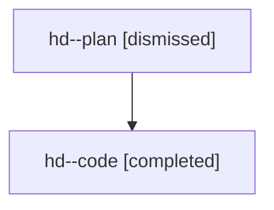

# Session: hd

[Agent Hoods](../README.md) / [bbugyi200](../users/bbugyi200/README.md) / [athena](../users/bbugyi200/machines/athena/README.md) / [hd](../users/bbugyi200/machines/athena/hoods/hd/README.md) / hd

Owner: `bbugyi200.athena` · Hood: `hd` · Members: 2

## Lineage

The diagram is an optional enhancement; the ordered table below contains the same lineage in accessible text.

| Role | Agent | State | Model / provider | Timing | Commits | Prompt | Chat |
|---|---|---|---|---|---:|---|---|
| plan | hd--plan | dismissed | gpt-5.6-sol / codex | 2026-07-21T15:02:57.253176 → 2026-07-21T15:22:26.973298 | 0 | [Prompt](../agents/bbugyi200.athena.hd--plan/prompt.md) | [Chat](../agents/bbugyi200.athena.hd--plan/chat.md) |
| code | hd--code | completed | gpt-5.6-sol / codex | 2026-07-21T19:10:09.239004+00:00 | [1](../agents/bbugyi200.athena.hd--code/README.md#commits) | — | [Chat](../agents/bbugyi200.athena.hd--code/chat.md) |

## Commits

| Role | Repo | Commit | Subject | Committed |
|---|---|---|---|---|
| code | — | `01b06e3` | fix(tui): keep artifact selection in viewport | 2026-07-21 15:22:12 EDT |
