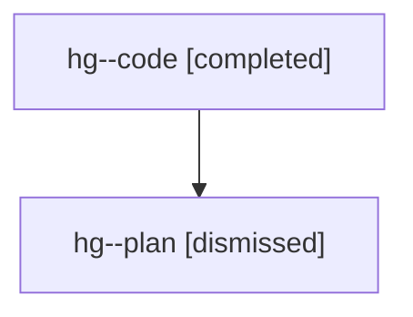

# Session: hg

[Agent Hoods](../README.md) / [bbugyi200](../users/bbugyi200/README.md) / [athena](../users/bbugyi200/machines/athena/README.md) / [hg](../users/bbugyi200/machines/athena/hoods/hg/README.md) / hg

Owner: `bbugyi200.athena` · Hood: `hg` · Members: 2

## Lineage

The diagram is an optional enhancement; the ordered table below contains the same lineage in accessible text.

| Role | Agent | State | Model / provider | Timing | Commits | Prompt | Chat |
|---|---|---|---|---|---:|---|---|
| code | hg--code | completed | gpt-5.6-sol / codex | 2026-07-21T20:07:17.284060+00:00 | [1](../agents/bbugyi200.athena.hg--code/README.md#commits) | — | [Chat](../agents/bbugyi200.athena.hg--code/chat.md) |
| plan | hg--plan | dismissed | gpt-5.6-sol / codex | 2026-07-21T15:59:05.762404 → 2026-07-21T16:19:58.261834 | 0 | [Prompt](../agents/bbugyi200.athena.hg--plan/prompt.md) | [Chat](../agents/bbugyi200.athena.hg--plan/chat.md) |

## Commits

| Role | Repo | Commit | Subject | Committed |
|---|---|---|---|---|
| code | — | `99d29be` | feat(vim): support visual surround selections | 2026-07-21 16:19:47 EDT |
