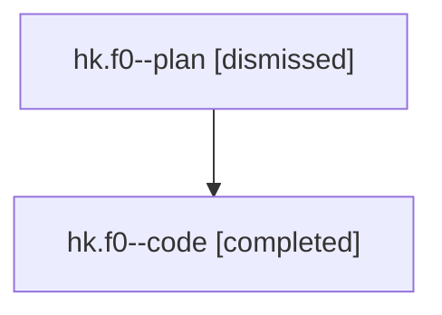

# Session: hk.f0

[Agent Hoods](../README.md) / [bbugyi200](../users/bbugyi200/README.md) / [athena](../users/bbugyi200/machines/athena/README.md) / [hk](../users/bbugyi200/machines/athena/hoods/hk/README.md) / hk.f0

Owner: `bbugyi200.athena` · Hood: `hk` · Members: 2

## Lineage

The diagram is an optional enhancement; the ordered table below contains the same lineage in accessible text.

| Role | Agent | State | Model / provider | Timing | Commits | Prompt | Chat |
|---|---|---|---|---|---:|---|---|
| plan | hk.f0--plan | dismissed | gpt-5.6-sol / codex | 2026-07-22T06:23:13.362616 → 2026-07-22T07:03:31.402394 | 0 | [Prompt](../agents/bbugyi200.athena.hk.f0--plan/prompt.md) | [Chat](../agents/bbugyi200.athena.hk.f0--plan/chat.md) |
| code | hk.f0--code | completed | gpt-5.6-sol / codex | 2026-07-22T10:31:06.694146+00:00 | [1](../agents/bbugyi200.athena.hk.f0--code/README.md#commits) | — | [Chat](../agents/bbugyi200.athena.hk.f0--code/chat.md) |

## Commits

| Role | Repo | Commit | Subject | Committed |
|---|---|---|---|---|
| code | — | `fe8c2e0` | fix(ace): navigate to all agent house parents | 2026-07-22 07:03:11 EDT |

## Neighbors

| Agent | Relation | State |
|---|---|---|
| [hk](../agents/bbugyi200.athena.hk/README.md) | ancestor | dismissed |
| [hk.f0.f0](bbugyi200.athena.hk.f0.f0.md) (session · 2) | descendant | completed 1, dismissed 1 |
