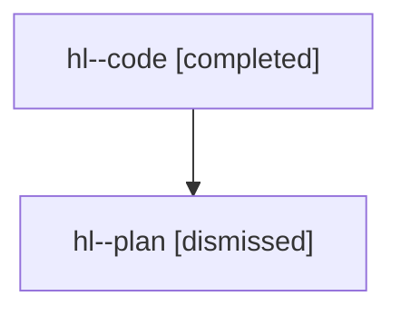

# Session: hl

[Agent Hoods](../README.md) / [bbugyi200](../users/bbugyi200/README.md) / [athena](../users/bbugyi200/machines/athena/README.md) / [hl](../users/bbugyi200/machines/athena/hoods/hl/README.md) / hl

Owner: `bbugyi200.athena` · Hood: `hl` · Members: 2

## Lineage

The diagram is an optional enhancement; the ordered table below contains the same lineage in accessible text.

| Role | Agent | State | Model / provider | Timing | Commits | Prompt | Chat |
|---|---|---|---|---|---:|---|---|
| code | hl--code | completed | gpt-5.6-sol / codex | 2026-07-21T20:47:58.285944+00:00 | [1](../agents/bbugyi200.athena.hl--code/README.md#commits) | — | [Chat](../agents/bbugyi200.athena.hl--code/chat.md) |
| plan | hl--plan | dismissed | gpt-5.6-sol / codex | 2026-07-21T16:37:18.894046 → 2026-07-21T17:14:50.753635 | 0 | [Prompt](../agents/bbugyi200.athena.hl--plan/prompt.md) | [Chat](../agents/bbugyi200.athena.hl--plan/chat.md) |

## Commits

| Role | Repo | Commit | Subject | Committed |
|---|---|---|---|---|
| code | — | `fd9db05` | fix(beads): publish epic graph before worker launch | 2026-07-21 17:14:40 EDT |
