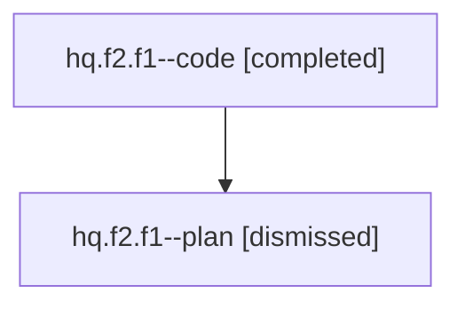

# Session: hq.f2.f1

[Agent Hoods](../README.md) / [bbugyi200](../users/bbugyi200/README.md) / [athena](../users/bbugyi200/machines/athena/README.md) / [hq](../users/bbugyi200/machines/athena/hoods/hq/README.md) / hq.f2.f1

Owner: `bbugyi200.athena` · Hood: `hq` · Members: 2

## Lineage

The diagram is an optional enhancement; the ordered table below contains the same lineage in accessible text.

| Role | Agent | State | Model / provider | Timing | Commits | Prompt | Chat |
|---|---|---|---|---|---:|---|---|
| code | hq.f2.f1--code | completed | gpt-5.6-sol / codex | 2026-07-22T13:03:50.554081+00:00 | 0 | — | [Chat](../agents/bbugyi200.athena.hq.f2.f1--code/chat.md) |
| plan | hq.f2.f1--plan | dismissed | gpt-5.6-sol / codex | 2026-07-22T08:55:17.277184 → 2026-07-22T09:24:26.550915 | 0 | [Prompt](../agents/bbugyi200.athena.hq.f2.f1--plan/prompt.md) | [Chat](../agents/bbugyi200.athena.hq.f2.f1--plan/chat.md) |

## Commits

| Role | Repo | Commit | Subject | Committed |
|---|---|---|---|---|
| — | — | `d32b2d4` | feat(ace): collapse clans from selected agent panel | 2026-07-22 09:23:52 EDT |

## Neighbors

| Agent | Relation | State |
|---|---|---|
| [hq.f2](bbugyi200.athena.hq.f2.md) (session · 2) | ancestor | completed 1, dismissed 1 |
| [hq](bbugyi200.athena.hq.md) (session · 2) | ancestor | completed 1, dismissed 1 |
| [hq.f2.f0](../agents/bbugyi200.athena.hq.f2.f0/README.md) | hq.f2 hood | dismissed |
| [hq.f0](../agents/bbugyi200.athena.hq.f0/README.md) | hq hood | dismissed |
