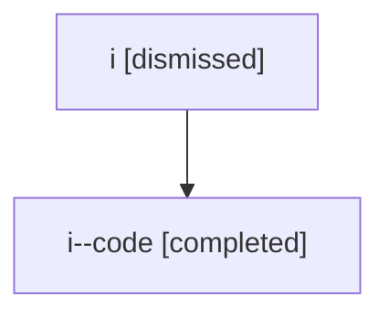

# Session: i

[Agent Hoods](../README.md) / [bbugyi200](../users/bbugyi200/README.md) / [athena](../users/bbugyi200/machines/athena/README.md) / [i](../users/bbugyi200/machines/athena/hoods/i/README.md) / i

Owner: `bbugyi200.athena` · Hood: `i` · Members: 2

## Lineage

The diagram is an optional enhancement; the ordered table below contains the same lineage in accessible text.

| Role | Agent | State | Model / provider | Timing | Commits | Prompt | Chat |
|---|---|---|---|---|---:|---|---|
| root | i | dismissed | claude-fable-5 / claude | 2026-07-06T14:21:15.037744 → 2026-07-06T15:41:43.262512 | [1](../agents/bbugyi200.athena.i/README.md#commits) | [Prompt](../agents/bbugyi200.athena.i/prompt.md) | [Chat](../agents/bbugyi200.athena.i/chat.md) |
| code | i--code | completed | gpt-5.5 / codex | 2026-07-06T18:32:38.036521+00:00 | [1](../agents/bbugyi200.athena.i--code/README.md#commits) | — | [Chat](../agents/bbugyi200.athena.i--code/chat.md) |

## Commits

| Role | Repo | Commit | Subject | Committed |
|---|---|---|---|---|
| root | — | `3fbd33d` | chore: Add SDD prompt and plan for sase\_ace\_demo\_video | 2026-07-06 14:32:36 EDT |
| code | — | `751145d` | feat(demos): add ACE prompt input demo video | 2026-07-06 15:41:18 EDT |

## Neighbors

| Agent | Relation | State |
|---|---|---|
| [i.f1](../agents/bbugyi200.athena.i.f1/README.md) | descendant | dismissed |
